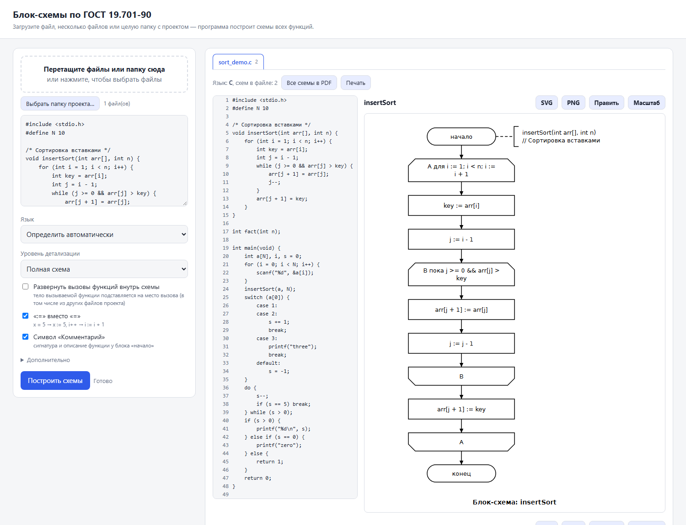
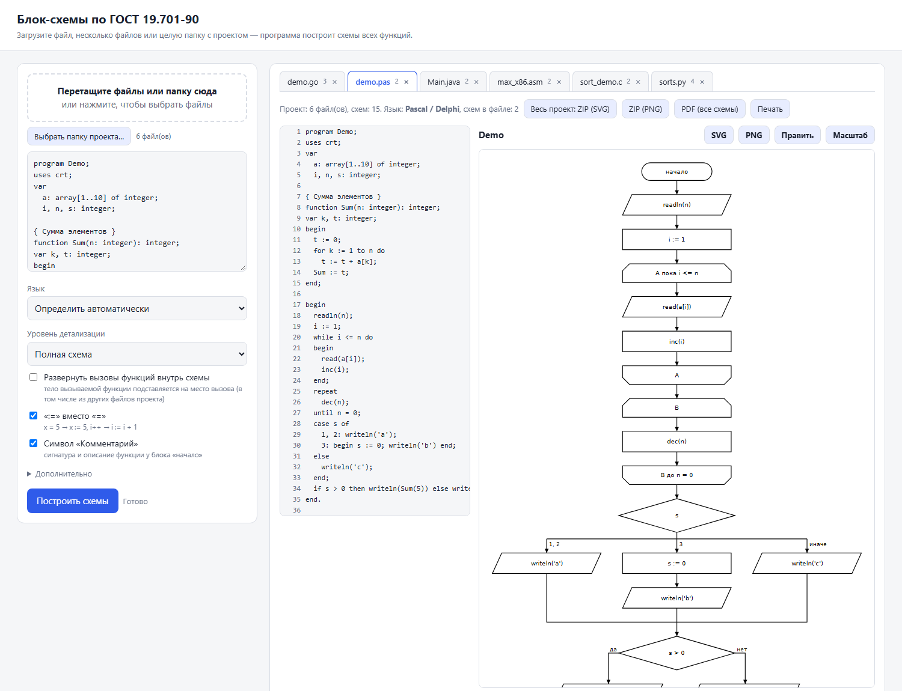
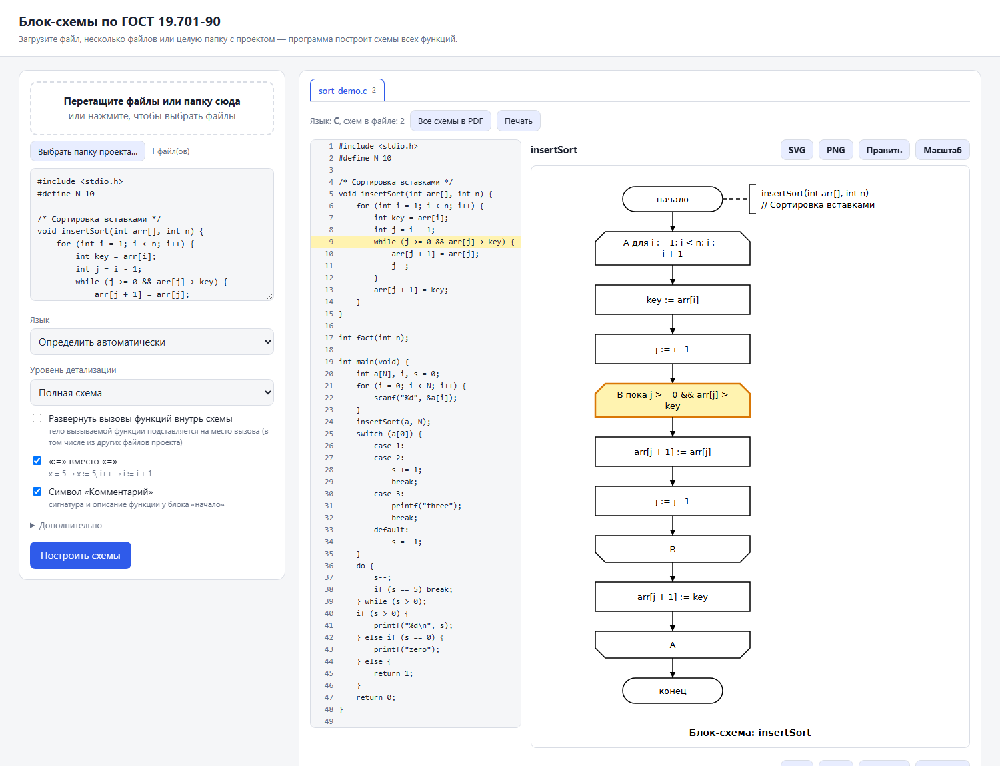
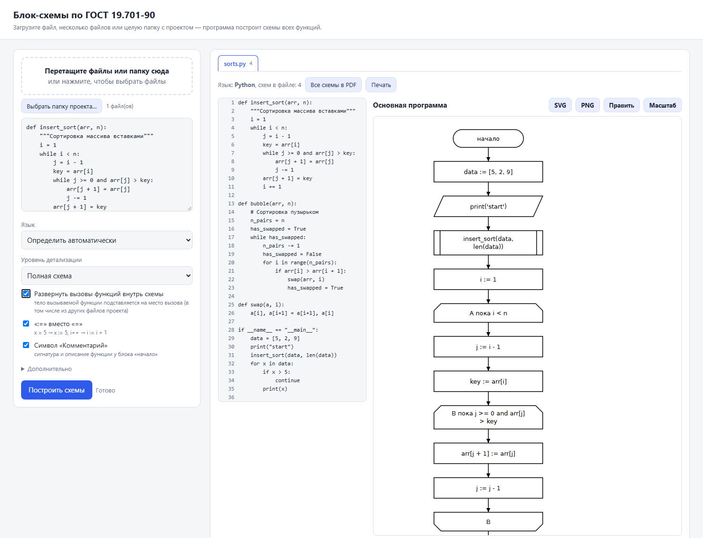
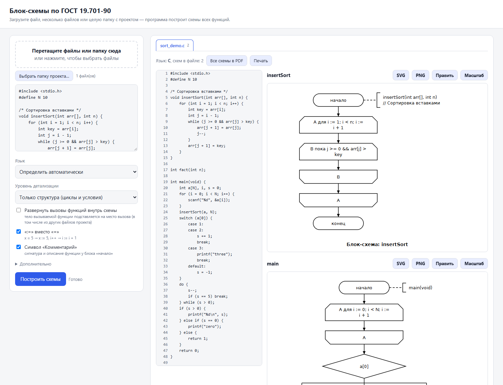
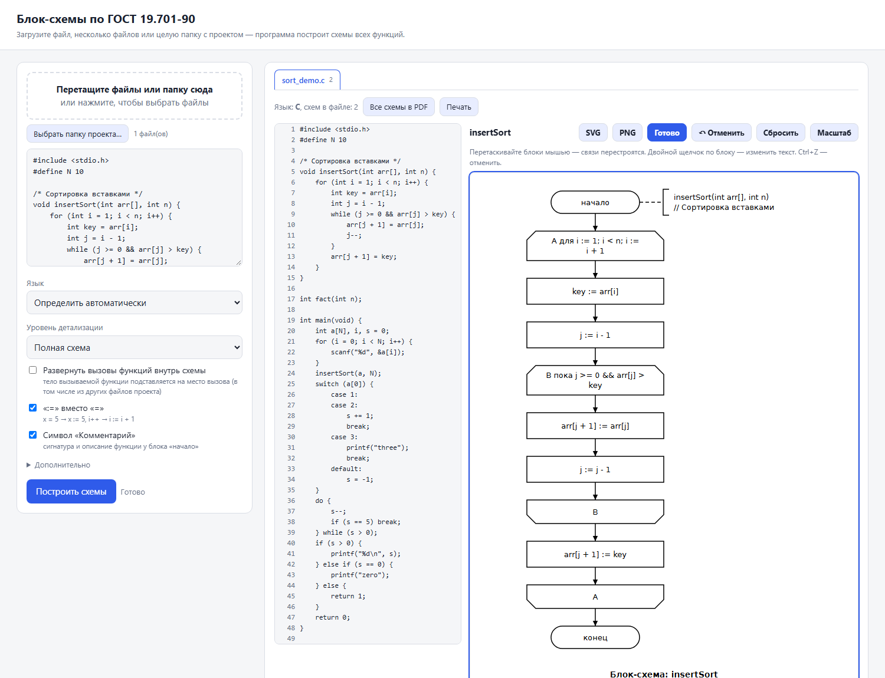
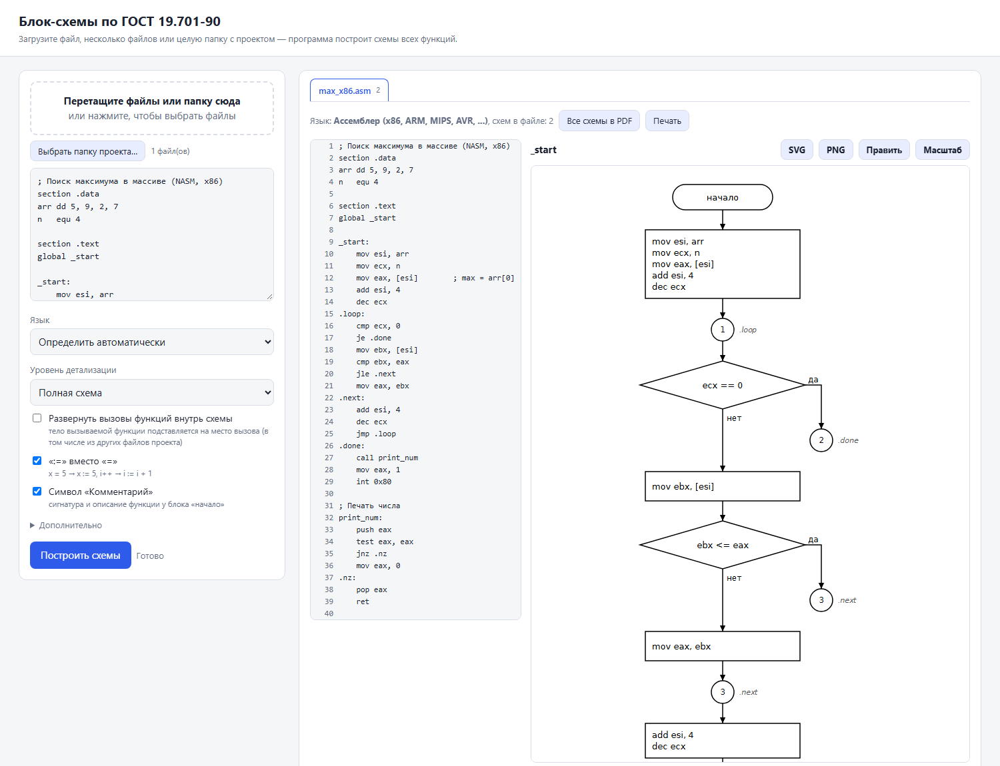
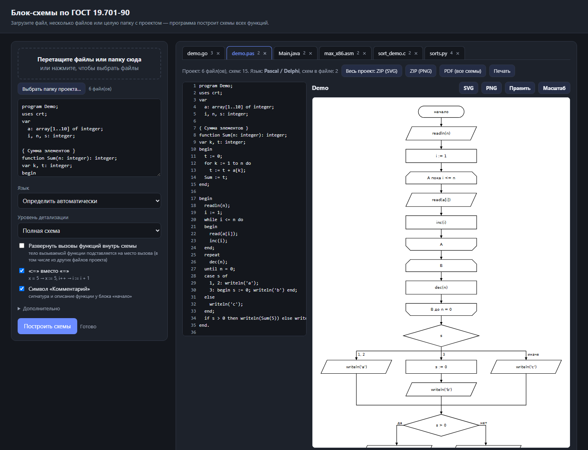
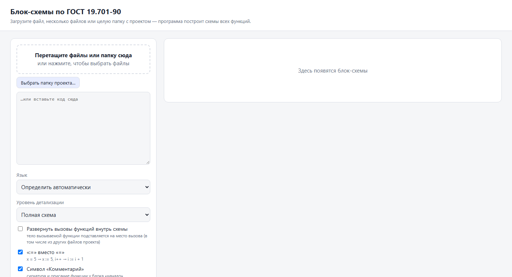
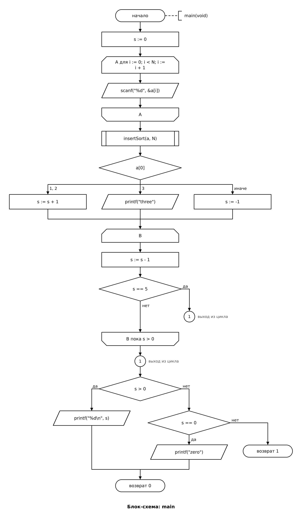

<div align="center">

# GostFlow

**Блок-схемы по исходному коду — в обозначениях ГОСТ 19.701-90**

Загрузите файл, несколько файлов или целую папку с проектом — получите схемы алгоритмов всех функций
в виде **SVG**, **PNG** и **PDF**.


-lightgrey)



</div>

---

## Содержание

- [Возможности](#возможности)
- [Скриншоты](#скриншоты)
- [Установка и запуск](#установка-и-запуск)
- [Описание функций интерфейса](#описание-функций-интерфейса)
- [Командная строка](#командная-строка)
- [Поддерживаемые языки](#поддерживаемые-языки)
- [Какие символы ГОСТ используются](#какие-символы-гост-используются)
- [Ассемблерный режим](#ассемблерный-режим)
- [Примеры результата](#примеры-результата)
- [Структура проекта](#структура-проекта)
- [Ограничения](#ограничения)

## Возможности

| | |
|---|---|
| 📄 **Схема на каждую функцию** | Для каждой функции/процедуры строится отдельная схема, плюс «Основная программа». |
| 📁 **Проект целиком** | Перетащите папку: каждый файл — вкладка; функции разных файлов «видят» друг друга. |
| 🔗 **Исходник ⇄ схема** | Клик по блоку подсвечивает строки кода, клик по строке — блоки на схеме. |
| 🎚 **Три уровня детализации** | Полная схема / структура + вызовы / только циклы и условия. |
| 🧩 **Разворачивание вызовов** | Тело вызываемой функции подставляется прямо в схему (глубина до 5). |
| ✏️ **Редактор схемы** | Блоки перетаскиваются мышью, текст правится двойным щелчком, есть отмена. |
| 💾 **Экспорт** | SVG, PNG, PDF, ZIP всего проекта, печать. |
| 🌐 **16 языков + ассемблер** | Python, C/C++, Java, C#, JS/TS, Go, Rust, PHP, Kotlin, Swift, Dart, Scala, Pascal, asm. |
| 🔒 **Локально** | Сервер слушает только `127.0.0.1`, код никуда не отправляется. |
| 🖥 **Один .exe** | Сборка в один файл для Windows, окно без адресной строки. |

## Скриншоты

### Загрузка проекта: каждый файл — вкладка



Перетащите в окно несколько файлов или папку. Над схемами — вкладки файлов, кнопки экспорта всего проекта
(ZIP SVG, ZIP PNG, один PDF) и печать.

### Подсветка: блок схемы ⇄ строка кода



Выбранный блок («пока j >= 0 && arr[j] > key») и соответствующая строка 9 исходника подсвечены.

### Развёрнутые вызовы функций



Вызов `insert_sort(data, len(data))` помечен символом предопределённого процесса, а его тело подставлено следом.

### Только структура



Остаются только циклы, условия и переходы — удобно для обзора сложной функции.

### Редактор поверх результата



Кнопка **«Править»**: блоки перетаскиваются мышью, связи перестраиваются автоматически.

### Ассемблер



### Тёмная тема



Тема переключается автоматически вслед за настройками системы.

### Пустое окно



## Установка и запуск

Нужен **Python 3.9+**. Для PNG/PDF дополнительно — Pillow (SVG работает без неё).

```bash
git clone https://github.com/Saltyrril/flowcharts.git
cd flowcharts
pip install -r requirements.txt     # необязательно: только для PNG/PDF
```

### Вариант 1. Веб-интерфейс

```bash
python flowchart.py
```

Откроется браузер на `http://127.0.0.1:8765/`. Перетащите файл или папку с кодом.

### Вариант 2. Оконное приложение

Двойной щелчок по `GostFlow.pyw` (без консоли) или:

```bash
python GostFlow.pyw
```

Открывается отдельное окно без адресной строки (Edge/Chrome в режиме `--app`). Закрыли окно — программа завершилась.

### Вариант 3. Один файл `GostFlow.exe` (Windows)

1. Установите Python 3.9+ c python.org (галочка «Add Python to PATH»).
2. Запустите `build_exe.bat` (нужен интернет — скачиваются PyInstaller и Pillow).
3. Через минуту появится `dist\GostFlow.exe` — один файл, его можно копировать куда угодно; Python больше не нужен.

## Описание функций интерфейса

### Левая панель

| Элемент | Что делает |
|---|---|
| **Область перетаскивания** | Принимает файлы и папки (в т. ч. вложенные); по клику открывает выбор файлов. |
| **Выбрать папку проекта…** | Загружает папку целиком. Служебные каталоги (`node_modules`, `.git`, `venv`, `build`, `dist`, `target`, `obj`…) и файлы больше 2 МБ пропускаются; максимум 400 файлов. |
| **Поле для кода** | Можно вставить код вручную. Кодировки UTF-8 и Windows-1251 определяются автоматически. |
| **Язык** | Автоопределение (по расширению и содержимому) или явный выбор из 16 языков. |
| **Уровень детализации** | «Полная схема», «Структура + вызовы функций», «Только структура (циклы и условия)». Смена перестраивает схемы сразу. |
| **Развернуть вызовы функций внутрь схемы** | Подставляет тело вызываемой функции (в т. ч. из другого файла проекта) на место вызова. Рекурсия не раскрывается; `return` превращается в присваивание результата или переход к соединителю «возврат из …». |
| **«:=» вместо «=»** | `x = 5` → `x := 5`, `i++` → `i := i + 1`. |
| **Символ «Комментарий»** | Сигнатура и описание функции рядом с блоком «начало». |
| **Дополнительно** | Глубина разворачивания (1–5), число простых операторов в одном блоке, показ объявлений без инициализации, настройки ассемблера (команд в блоке, комментарии из исходника). |
| **Построить схемы** | Перестраивает схемы. Если есть ручные правки — спросит подтверждение. |

### Правая панель

| Элемент | Что делает |
|---|---|
| **Вкладки файлов** | Один файл — одна вкладка; число на вкладке — количество схем; `×` убирает файл из проекта. |
| **Панель проекта** | Показывает язык и число схем; кнопки **«Весь проект: ZIP (SVG)»**, **ZIP (PNG)**, **PDF (все схемы)**, **Печать**. |
| **Код с номерами строк** | Клик по строке подсвечивает соответствующие блоки и прокручивает схему к ним. |
| **Блоки схемы** | Клик по блоку подсвечивает строку(и) кода; для развёрнутого вызова откроет вкладку файла, где функция определена. |
| **SVG / PNG** | Скачать схему одной функции. Для отредактированной схемы скачивается именно правленая версия. |
| **Править** | Включает режим редактора (см. ниже). Повторное нажатие («Готово») выходит из режима. |
| **↶ Отменить / Сбросить** | Появляются после правок: откат последнего действия (`Ctrl+Z`) или возврат к автоматической раскладке. |
| **Масштаб** | Переключает «вписать по ширине» / «реальный размер». |
| **Печать** | Печатает схемы по одной на страницу (боковая панель и кнопки скрываются). |

### Редактор схемы

* **Перетаскивание блоков** мышью с шагом 5 px — связи и подписи «да/нет» перестраиваются автоматически.
* **Двойной щелчок** по блоку — диалог «Текст блока»; размер блока пересчитывается под новый текст.
* **Ctrl+Z** — отмена; **Сбросить** — вернуть автоматическую раскладку.
* Ручные правки хранятся только в открытой странице и пропадают при перестроении — программа предупредит.

## Командная строка

```bash
python flowchart.py                              # веб-интерфейс
python flowchart.py prog.c                       # схемы в каталог ./flowcharts (SVG)
python flowchart.py my_project/                  # вся папка проекта
python flowchart.py a.py --detail structure --expand 2
python flowchart.py a.py b.asm -f svg,png,pdf -o out
python flowchart.py --list-langs                 # список языков
```

| Ключ | Описание |
|---|---|
| `files` | Файлы и/или папки проекта (язык определяется по расширению). Без аргументов запускается веб-интерфейс. |
| `-l`, `--lang` | Язык принудительно (по умолчанию — автоопределение). |
| `-o`, `--out` | Каталог результата (по умолчанию `./flowcharts`). |
| `-f`, `--format` | Форматы через запятую: `svg`, `png`, `pdf` (по умолчанию `svg`). |
| `--detail` | `full` — полная, `calls` — структура + вызовы, `structure` — только циклы и условия. |
| `--expand N` | Развернуть вызовы функций проекта внутрь схемы (глубина N). |
| `--merge N` | Объединять до N подряд идущих простых операторов в один блок. |
| `--keep-assign` | Не заменять `=` на `:=` и не упрощать `i++` / `x += 1`. |
| `--keep-decl` | Показывать объявления переменных без инициализации. |
| `--no-comment` | Не рисовать символ «Комментарий» у блока «начало». |
| `--asm-group N` | Ассемблер: максимум команд в одном блоке (по умолчанию 6). |
| `--asm-comments` | Ассемблер: добавлять комментарии из исходника в блоки. |
| `--serve` | Запустить веб-интерфейс. |
| `--port` | Порт веб-интерфейса (по умолчанию 8765). |
| `--no-browser` | Не открывать браузер автоматически. |
| `--list-langs` | Показать поддерживаемые языки. |

## Поддерживаемые языки

Python (через `ast`), C, C++, Java, C#, JavaScript, TypeScript, Go, Rust, PHP, Kotlin, Swift, Dart, Scala,
Pascal/Delphi и **ассемблер** (x86 Intel/AT&T, ARM/AArch64, MIPS, RISC-V, AVR, 6502, 68k — по мнемоникам).

Примеры исходников лежат в папке [`examples/`](examples).

## Какие символы ГОСТ используются

| Конструкция кода | Символ |
|---|---|
| начало / конец / `return` / `throw` / `exit` / `hlt` | Терминатор |
| присваивания, выражения | Процесс |
| вызов функции, объявленной в проекте; `call`/`bl`/`jsr` | Предопределённый процесс (двойные полосы) |
| `print`, `scanf`, `cin`, `input`, `readln`, … | Данные (параллелограмм) |
| `if`, `switch/case`, `match`, `when`, `try/catch` («Исключение?»), условные переходы в asm | Решение (многовыходное — ветвление линии, п. 4.3.1) |
| `for`, `while`, `do…while`, `repeat…until`, `loop` | Граница цикла (парные символы с общим идентификатором: `A …` / `A`; условие сверху или снизу) |
| `break`, `continue`, `goto`, метки, `jmp`/`b`/`j` в asm | Соединитель с номером (внешний и внутренний) |
| сигнатура и комментарий над функцией | Комментарий (скобка + пунктир, п. 3.4.3) |

Линии входят в символ сверху, выходят снизу/справа, пересечений нет; ветви помечены «да»/«нет» (п. 4.3.1.2).

## Ассемблерный режим

Код разбивается на схемы по `proc/endp` либо по меткам — целям `call`. Подряд идущие команды объединяются в один блок
(`--asm-group N`). Пара `cmp a, b` + `jl метка` превращается в решение `a < b`: учитываются знаковые/беззнаковые
переходы, `test`, `dec/sub` + `jnz`, `loop`, `cbz`, `beq r1,r2` и др.; распознаётся AT&T-порядок операндов.
Условный/безусловный переход на метку — соединитель с номером и подписью имени метки, на целевой метке стоит парный соединитель.

## Примеры результата

Исходник — [`examples/sort_demo.c`](examples/sort_demo.c) (цикл `for`, `do…while`, `switch`, `break`, вложенные `if`, вызов функции).
Готовые схемы лежат в [`docs/charts/`](docs/charts): SVG (векторные) и PNG.

<div align="center">

</div>

## Структура проекта

```
flowchart.py          консольный запуск / веб-интерфейс
GostFlow.pyw          оконное приложение (двойной щелчок)
build_exe.bat         сборка dist\GostFlow.exe (PyInstaller)
gostflow/
  cli.py              аргументы командной строки, обход папок
  core.py             определение языка, сборка схем проекта
  ir.py               промежуточное представление, уровни детализации, разворачивание вызовов
  lang_python.py      разбор Python (ast)
  lang_clike.py       разбор C-подобных языков
  lang_pascal.py      разбор Pascal / Delphi
  lang_asm.py         разбор ассемблера
  layout.py           раскладка блоков и маршрутизация линий
  render.py           вывод SVG / PNG / PDF
  server.py           локальный HTTP-сервер и API
  desktop.py          окно без адресной строки
  webui.py, webcore.py  страница интерфейса и редактор (HTML + JS)
examples/             примеры исходников на разных языках
docs/                 скриншоты и готовые схемы для README
PROJECT_OVERVIEW.md   полное описание проекта для разработчиков
```

## Ограничения

* Разбор C-подобных языков — собственный синтаксический анализатор без препроцессора и семантики: макросы, шаблоны
  и нестандартный синтаксис могут быть показаны как обычные операторы; вложенные анонимные функции (колбэки)
  показываются одним блоком с `{…}`.
* Лямбда-выражения и `if/else` внутри выражений (`return a if x else b`) не раскрываются в ветвления.
* Схемы не разбиваются на листы A4 (по ГОСТ длинные схемы разрывают соединителями): SVG масштабируется без потерь.
* Ассемблер: макросы и вычисляемые переходы (`jmp eax`, таблицы переходов) показываются как терминатор «переход: …».
* Ручные правки хранятся только в открытой странице и не попадают в серверный PDF/ZIP: сохраняйте результат кнопками SVG/PNG.
* Не реализовано: разбиение на листы A4 с межстраничными соединителями, рамка и основная надпись (штамп),
  экспорт в Word/draw.io/Visio, проверка схемы на соответствие ГОСТ.
* Развёрнутый вызов не подставляет фактические параметры в тело функции; `try/catch` изображается как решение «Исключение?».
* PDF растровый (150 dpi). Шрифты PNG/PDF берутся из системы (DejaVu, Segoe UI, Arial, Liberation).
* Ассемблеры Z80/8051 принимаются по расширению, но их специфические переходы (`djnz`, `jp nz`) не реализованы.
* Автотестов в репозитории пока нет. Сборка `GostFlow.exe` на Windows и работа оконного режима Edge `--app` автором
  описания не проверялись; веб-интерфейс прогнан в Edge (скриншоты выше сняты с реальной работы программы).

Подробное описание архитектуры, IR, парсеров и API — в [PROJECT_OVERVIEW.md](PROJECT_OVERVIEW.md).
